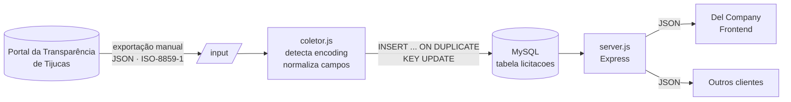
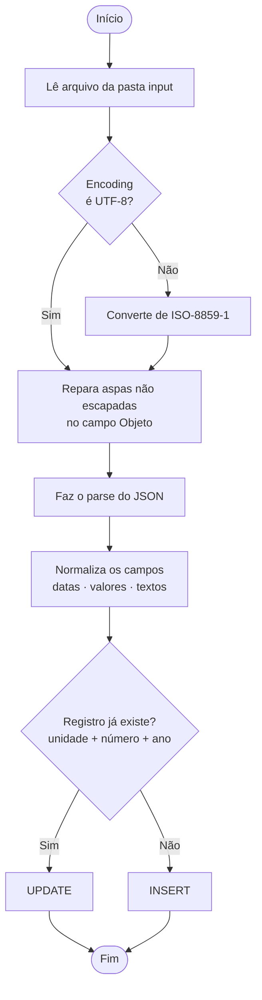
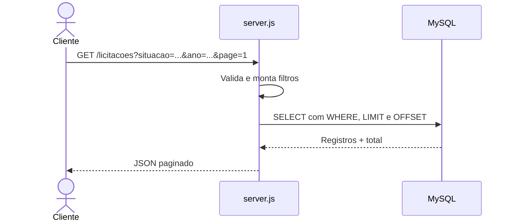

<div align="center">

# API de Licitações — Tijucas/SC

**API REST com dados reais de licitações do Portal da Transparência do Município de Tijucas**

Coleta, normalização e consulta de licitações públicas, no estilo de APIs como a DummyJSON, mas com dados reais.


[API em produção](https://api-licitacoes-production.up.railway.app/licitacoes) · [Fonte dos dados](https://tijucas.atende.net/transparencia/item/licitacoes-gerais) · [Reportar problema](https://github.com/elibernardi1/api-licitacoes/issues)

</div>

---

## Sobre o projeto

O Portal da Transparência de Tijucas publica as licitações do município, mas não oferece uma API para consumo. Este projeto resolve isso: ele **recebe os dados exportados do portal, normaliza, grava em um banco MySQL e os expõe por uma API REST** pública, com paginação, filtros e busca.

A API alimenta o catálogo da plataforma **Del Company** (assessoria em licitações), mas pode ser usada por qualquer aplicação que precise consultar licitações de Tijucas.

### Por que a coleta é manual?

O endpoint interno do portal possui proteção anti-bot que bloqueia a coleta automatizada. Por isso, a estratégia adotada foi **exportar os dados pelo botão de impressão/exportação do portal, em formato JSON**, e processar o arquivo com o coletor deste repositório.

## Funcionalidades

- **Dados reais** extraídos do Portal da Transparência de Tijucas
- **Coletor** que lê o arquivo exportado e grava no banco
- **Detecção automática de encoding**: o portal exporta em ISO-8859-1 (Latin-1), e o coletor converte corretamente
- **Tolerância a JSON inválido**: o campo *Objeto* vem com aspas internas não escapadas, e o coletor trata o problema
- **Idempotência**: reexecutar o coletor atualiza registros existentes em vez de duplicar (`INSERT ... ON DUPLICATE KEY UPDATE`)
- **Listagem paginada** com filtros por situação, unidade gestora e ano
- **Busca textual** por termo
- **Consulta por ID**

## Tecnologias

| Camada | Tecnologia |
| --- | --- |
| Runtime | Node.js |
| Framework | Express |
| Banco de dados | MySQL (driver `mysql2`) |
| Hospedagem | Railway (API + MySQL gerenciado) |

## Arquitetura



## Fluxo do coletor



## Fluxo de uma requisição



## Endpoints

**URL base (produção):** `https://api-licitacoes-production.up.railway.app`

| Método | Rota | Descrição |
| --- | --- | --- |
| `GET` | `/licitacoes` | Lista licitações com paginação e filtros |
| `GET` | `/licitacoes/:id` | Retorna uma licitação pelo ID |
| `GET` | `/licitacoes/search?q=termo` | Busca textual |

### Filtros de `/licitacoes`

| Parâmetro | Descrição | Exemplo |
| --- | --- | --- |
| `situacao` | Filtra pela situação da licitação | `?situacao=Homologada` |
| `unidadeGestora` | Filtra pela unidade gestora | `?unidadeGestora=Prefeitura` |
| `ano` | Filtra pelo ano da licitação | `?ano=2025` |

### Exemplos

```bash
# Primeira página de licitações
curl "https://api-licitacoes-production.up.railway.app/licitacoes"

# Filtrando por ano
curl "https://api-licitacoes-production.up.railway.app/licitacoes?ano=2025"

# Buscando por termo
curl "https://api-licitacoes-production.up.railway.app/licitacoes/search?q=pavimentacao"
```

```javascript
// Consumindo no frontend
const resposta = await fetch(
  "https://api-licitacoes-production.up.railway.app/licitacoes?ano=2025"
);
const dados = await resposta.json();
console.log(dados);
```

### Endpoints complementares

| Método | Rota | Descrição |
| --- | --- | --- |
| `GET` | `/health` | Verificação de saúde do serviço |
| `GET` | `/api/status` | Status da API |
| `GET` | `/api/modalidades` | Modalidades disponíveis |
| `GET` | `/api/situacoes` | Situações disponíveis |

Esses endpoints também aceitam os filtros `dataInicio` e `dataFim`, e a busca varre **objeto**, **modalidade** e **unidade gestora**.

## Campos dos dados

Campos extraídos do portal e armazenados no banco:

| Campo | Descrição |
| --- | --- |
| Modalidade | Modalidade da licitação |
| Licitação (Número/Ano) | Identificação da licitação |
| Data Homologação | Data de homologação |
| Data Edital | Data de publicação do edital |
| Data Adjudicação | Data de adjudicação |
| Tipo de Concorrência | Tipo de concorrência |
| Objeto | Descrição do objeto licitado |
| Situação | Situação atual do processo |
| Processo Administrativo (Número/Ano) | Identificação do processo |
| Abertura das Propostas | Data de abertura das propostas |
| Abertura da Sessão | Data de abertura da sessão |
| TCE (Registro / Nº Processo Termo) | Dados do Tribunal de Contas |
| Valor (Estimado/Homologado) | Valores da licitação |
| Carona | Indica adesão a ata de registro de preços |
| Unidade Gestora | Órgão responsável |

A combinação **unidade gestora + número + ano da licitação** é única no banco, o que impede duplicatas.

## Estrutura do repositório

```
api-licitacoes/
├── input/          # Arquivos JSON exportados do portal (entrada do coletor)
├── coletor.js      # Lê, normaliza e grava os dados no MySQL
├── server.js       # API REST (Express)
├── package.json
├── package-lock.json
└── .gitignore
```

## Como executar localmente

### Pré-requisitos

- [Node.js](https://nodejs.org/) 18 ou superior
- [MySQL](https://www.mysql.com/) em execução
- npm

### Passo a passo

**1. Clone o repositório**

```bash
git clone https://github.com/elibernardi1/api-licitacoes.git
cd api-licitacoes
```

**2. Instale as dependências**

```bash
npm install
```

**3. Configure o banco de dados**

Crie o banco e a tabela `licitacoes`, com restrição única por unidade gestora, número e ano:

```sql
CREATE DATABASE licitacoes CHARACTER SET utf8mb4 COLLATE utf8mb4_unicode_ci;
```

Defina as credenciais de conexão (host, usuário, senha e nome do banco) nas variáveis de ambiente usadas pelo `coletor.js` e pelo `server.js`.

**4. Exporte os dados do portal**

1. Acesse as [Licitações Gerais](https://tijucas.atende.net/transparencia/item/licitacoes-gerais) no Portal da Transparência.
2. Use o botão de impressão/exportação e escolha o formato **JSON**.
3. Salve o arquivo na pasta `input/`.

**5. Execute o coletor**

```bash
node coletor.js
```

**6. Inicie a API**

```bash
node server.js
```

A API ficará disponível em `http://localhost:3000/licitacoes`, ou na porta configurada no ambiente.

## Atualizando os dados

Sempre que o portal publicar novas licitações:

1. Exporte um novo JSON do portal.
2. Substitua o arquivo em `input/`.
3. Execute `node coletor.js` novamente.

Registros já existentes são atualizados e os novos são inseridos, sem duplicatas.

## Deploy

A API roda no **Railway**, com banco MySQL gerenciado pela própria plataforma.

1. Crie um projeto no Railway e adicione um serviço **MySQL**.
2. Conecte este repositório como um novo serviço.
3. Configure as variáveis de conexão com o banco.
4. Rode o coletor uma vez para popular a tabela.
5. O Railway expõe a API em uma URL pública.

## Roadmap

- [x] Coletor com detecção de encoding e reparo de JSON
- [x] Gravação idempotente no MySQL
- [x] Listagem paginada, consulta por ID e busca
- [x] Deploy no Railway
- [x] CORS habilitado para consumo pelo frontend
- [ ] Documentação interativa (Swagger/OpenAPI)
- [ ] Rotina para automatizar a atualização dos dados
- [ ] Testes automatizados

## Projetos relacionados

| Repositório | Descrição |
| --- | --- |
| [proj-implantar-frontend](https://github.com/eli-bernardi/proj-implantar-frontend) | Frontend da plataforma Del Company, que consome esta API |
| [proj_implantar](https://github.com/elibernardi1/proj_implantar) | Backend da plataforma Del Company |

## Fonte dos dados e aviso

Os dados são públicos e foram obtidos no [Portal da Transparência do Município de Tijucas](https://tijucas.atende.net/transparencia/item/licitacoes-gerais). Este projeto **não é oficial** e não possui vínculo com a Prefeitura de Tijucas. Para informações oficiais e atualizadas, consulte sempre o portal.

## Autor

**Eli Bernardi**

Projeto desenvolvido durante o curso Técnico em Desenvolvimento de Sistemas, no SESI/SENAI Digital Studios.

---

<div align="center">

Feito com dados abertos de Tijucas/SC

</div>
